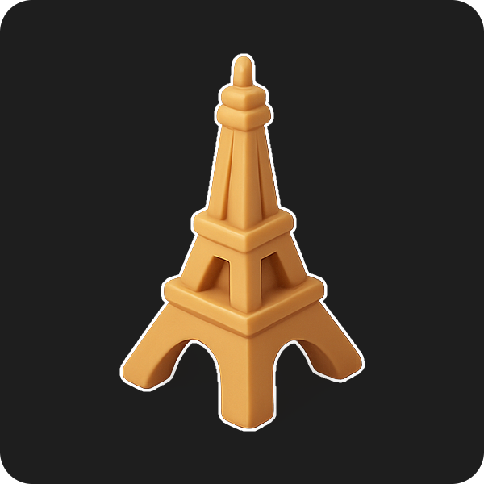
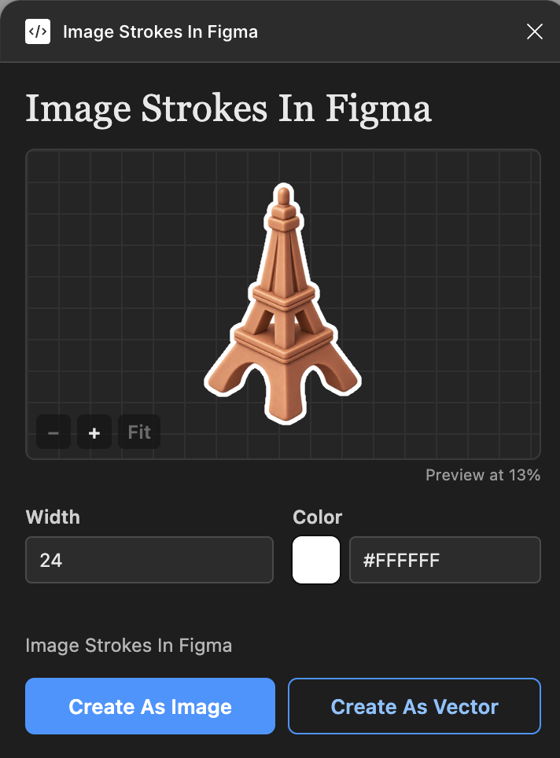
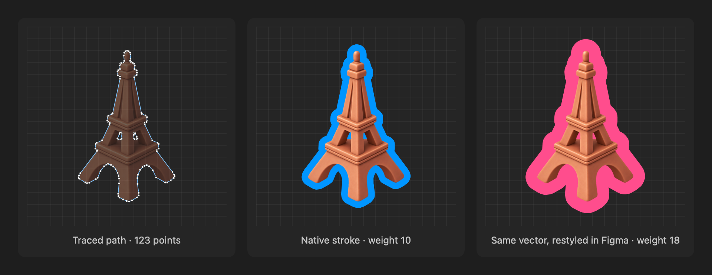
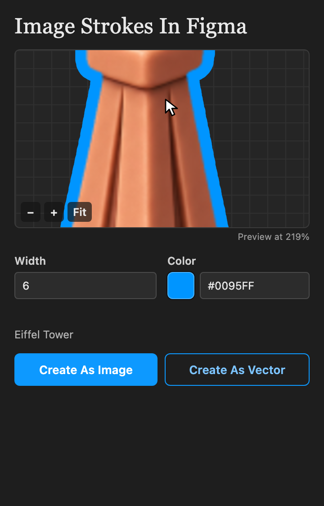
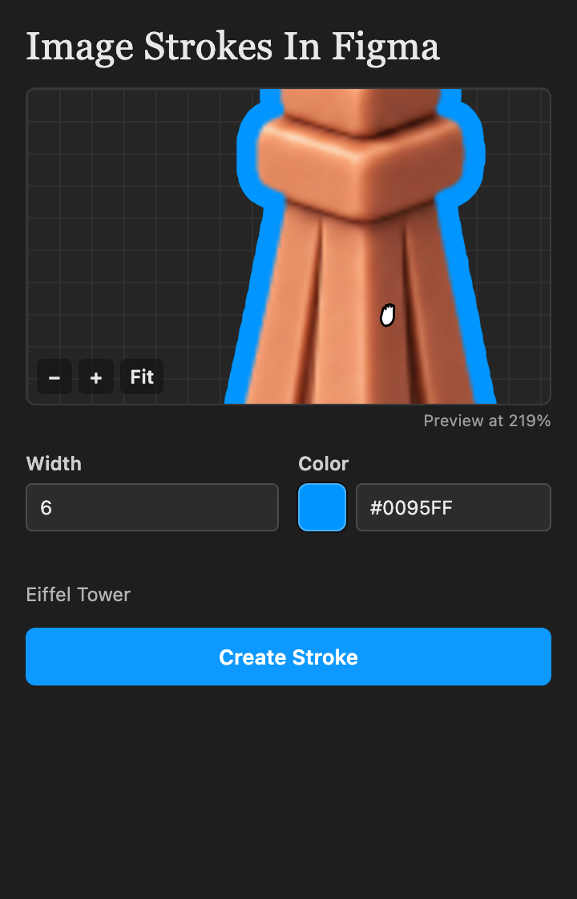
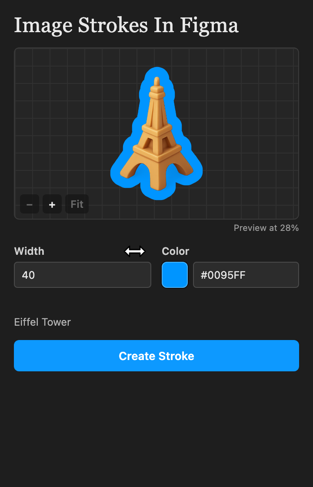

<div align="center">

<h1>Image Strokes In Figma</h1>

<hr>

<p><strong>Outlines for raster images; a Figma plugin written in plain TypeScript.</strong><br>
Adds a stroke around an image that follows the picture's alpha silhouette,<br>
not the rectangle it sits in. Two outputs: <strong>a flat image</strong> with the outline baked in, or <strong>an editable vector stroke</strong>.<br>
No framework, no image library, no network. Open source, offline, and yours.</p>

<p>


</p>



<p><em>Rendered by the plugin's own stroke code (<code>node scripts/cover.mjs</code>).</em></p>

</div>

Select one image, pick a width and a color, press Create As Image or Create As Vector, and the result appears next to it with the outline. That's the whole idea.

Figma strokes vectors natively, but a stroke on an image layer only follows the rectangle, not the picture inside it. This plugin traces what is actually visible in the image instead.

## Features

### Two outputs: an image or a vector

The panel has two buttons, and they give you the same outline in two different forms. Same width, same color, same silhouette; pick by what you want to do with the result afterwards.

<table>
<tr>
<td width="50%" valign="top">

#### Create As Image

One new raster layer: the image with the outline baked into it.

- A single flat layer, nothing to keep together.
- Looks the same wherever it goes: exports, handoff, other tools.
- The edge is anti-aliased pixel by pixel.
- To change the width or color, create it again.

</td>
<td width="50%" valign="top">

#### Create As Vector

A group: a vector with a native Figma stroke, under a copy of the image.

- The stroke stays editable in Figma: weight, color, join.
- Scales to any size without going soft.
- Run Outline Stroke on it to get a plain shape.
- Two layers in a group instead of one.

</td>
</tr>
</table>

<p align="center">

</p>

<p align="center"><em>The panel in Figma, with both buttons.</em></p>

Either way the source image is left untouched and the result lands next to it.

### A real vector stroke, not a picture of one



<p><em>The silhouette traced into a path, the stroke Figma draws on it, and the same vector after a change of weight and color. Rendered from the plugin's own tracing code (<code>node scripts/vector-figure.mjs</code>); the restyled panel illustrates an edit you would make in Figma.</em></p>

**Create As Vector** does not flatten anything. It traces the outline of what is visible in the image into a vector path, puts a native Figma stroke on that path, and groups it under a copy of the image. Because the stroke is Figma's own, it is still yours to change afterwards: drag the weight, pick another color, switch the join, or run Outline Stroke to turn it into a plain shape. Holes inside the image are traced too.

### In the panel

Every screenshot below is the real plugin UI, rendered headless from the same build you install (`node scripts/screenshots.mjs`).

<table>
<tr>
<td width="33%" valign="top">



<p><em>Zoomed to 219%: the stroke edge up close, before anything is created.</em></p>

### Zoom in on the edge

A stroke is judged at its edge, and a whole image squeezed into a small box hides it. Scroll over the preview to zoom towards the cursor, up to 8x, or use the <strong>−</strong> and <strong>+</strong> buttons. The caption always says how large you are looking at it, and <strong>Fit</strong> or a double-click brings the whole image back.

</td>
<td width="33%" valign="top">



<p><em>Same zoom, dragged across to another part of the image.</em></p>

### Pan around

Once you are zoomed in, drag the preview to move across the image and check the corners, the thin parts and the gaps where a stroke tends to go wrong. The arrow keys do the same when the preview has focus. Selecting another image starts again from the fitted view.

</td>
<td width="33%" valign="top">



<p><em>Dragging the Width label: 40 and counting, the preview following.</em></p>

### Scrub the width

Hover the <strong>Width</strong> label and the cursor turns into a left-right arrow. Press and drag right to raise the value, left to lower it, and the preview redraws as you go. Hold Shift for steps of 10. Typing a number still works, and a plain click on the label just focuses the field.

</td>
</tr>
</table>

## Getting it running

```sh
npm install
npm run build
```

Then in Figma: **Plugins → Development → Import plugin from manifest…** and pick `manifest.json` from this folder. Select an image, run *Image Strokes In Figma*, press Create As Image or Create As Vector.

`dist/` is gitignored, so you need to build before Figma can load it.

Other scripts:

| Script | What it does |
| --- | --- |
| `npm run watch` | rebuild on every change |
| `npm test` | unit tests (node's built-in test runner) |
| `npm run typecheck` | `tsc --noEmit` |

### Poking at the UI without Figma

The UI is one self-contained HTML file and only talks to the plugin thread through `postMessage`, so you can open `dist/ui.html` straight in a browser. The width field, the color picker and the preview all work there; with no plugin thread behind it there is no selection, so both Create buttons stay disabled. Useful for CSS tweaks; not a substitute for testing in Figma.

## Using it

- **Width**: a whole number from 1 to 200, in document units. Drag the *Width* label left or right to change it; hold Shift to move in steps of 10.
- **Color**: the swatch opens a picker with a saturation/brightness area, a hue slider and preset swatches. Where the browser supports the EyeDropper API there is also an eyedropper button. The HEX field next to the swatch accepts `#RGB` and `#RRGGBB`.
- **Preview**: the image you have selected, stroked with the same code that produces the real result and drawn at its true proportion, so a thin stroke on a large image looks thin. When image and stroke do not fit the box at full size the preview shrinks and says "Preview at N%". With nothing usable selected the box just says "Select an Image". Scroll (or use the − and + buttons) to zoom up to 8x, drag to pan, double-click or press Fit to go back.
- **Create As Image**: makes one new raster layer, the image with its outline baked in.
- **Create As Vector**: traces the image's silhouette into a vector and gives that vector a native Figma stroke (round joins, the width you picked on each side of the path), then groups it under a copy of the image. The stroke stays editable: change its weight or color in Figma afterwards, or run Outline Stroke on it.

Either way the result is named `<source name> — Stroke`, lands 32 units to the right of the source and gets selected. The source is left untouched and the panel stays open.

Changing settings never writes to the document; only the two Create buttons do.

## What gets a stroke

Yes:

- Exactly one selected rectangle whose only visible fill is an image (normal blend, full opacity).

No (the panel says why and both Create buttons stay disabled):

- Vectors, shapes, text, frames and groups.
- Several layers selected at once.
- Images with extra fills, strokes, effects, reduced opacity or a blend mode.

Also no (pressing Create reports the reason and adds nothing to the document):

- Fully transparent images.
- Results that would exceed 4096 px on a side or 8 megapixels.
- For a vector: silhouettes too detailed to fit 6000 path points even after simplifying.

Worth knowing:

- Create As Image gives a raster image; Create As Vector gives a straight-segment path, simplified so it stays within a fraction of a pixel of the traced edge at the export scale.
- Soft edges count as inside from 50 % alpha up, in both outputs. A vector edge is crisp, so on images with shadows or glows the two results differ slightly there.
- A fully opaque image gets a rectangular outline, because its silhouette is the rectangle.
- The export is 2x, and falls back to 1x when 2x does not fit the limits above.

## How it's built

```
manifest.json            Figma manifest (dynamic-page, no network)
scripts/build.mjs        esbuild: src/main.ts → dist/main.js, src/ui/* → dist/ui.html
scripts/cover.mjs        renders docs/cover.png (animated) from docs/cover-source.png
scripts/screenshots.mjs  renders the panel screenshots in docs/features/ with headless Chrome
scripts/vector-figure.mjs  renders docs/features/vector.png from the tracing code
src/main.ts              plugin thread: selection checks, export, job lifecycle, creates the layer or the vector group
src/shared/messages.ts   message protocol between the two sides, with runtime guards
src/image/validation.ts  width and HEX parsing, size limits, export planning, path data checks
src/image/stroke.ts      distance transform and stroke compositing on raw RGBA pixels
src/image/trace.ts       marching squares: alpha silhouette to closed contours
src/image/simplify.ts    contour simplification, point budget, SVG path data
src/ui/index.html        panel markup
src/ui/main.ts           panel logic: fields, preview, render jobs, messages
src/ui/scrub.ts          drag-the-label number scrubbing
src/ui/picker.ts         color picker (+ picker.css)
src/ui/preview.ts        preview layout: fits the stroked image into the box
src/ui/view.ts           preview zoom and pan math
tests/                   unit tests for stroke, trace, simplify, validation, scrub, preview and view
```

A few things worth knowing if you dig in:

- The plugin thread owns the document; the iframe does the pixel work. The plugin thread exports the source as PNG, the panel draws the stroke on a canvas and sends the result back.
- The stroke uses an exact Euclidean distance transform in two passes, so a wide stroke costs the same as a thin one.
- Pixels with an alpha of at least 50 % form the silhouette. The original pixels are composited on top unchanged.
- The vector path comes from marching squares on the alpha channel with interpolated crossings, then Ramer-Douglas-Peucker. The outward growth is not computed at all there: a round-joined stroke on the traced path is the same shape, and Figma draws it.
- Every job carries a request id and a selection revision. If the selection or the source changes in the meantime, the result is dropped.
- One job runs at a time.

## Status

v0.1.0, early alpha. It builds, type-checks and passes its unit tests, and the panel has been exercised in a browser. In Figma the panel opens, previews the selection, and Create As Vector has been tried by hand and produced a correct, editable result. Nothing beyond that has been tested systematically there.

Open questions: whether creating the layer is a single Undo step, how rotated or cropped sources and sources inside Auto Layout or scaled parents behave, how the eyedropper behaves in Figma desktop, and how it performs on large images.

## License

MIT. See [LICENSE](LICENSE).

This is an independent project; it is not affiliated with or endorsed by Figma.
